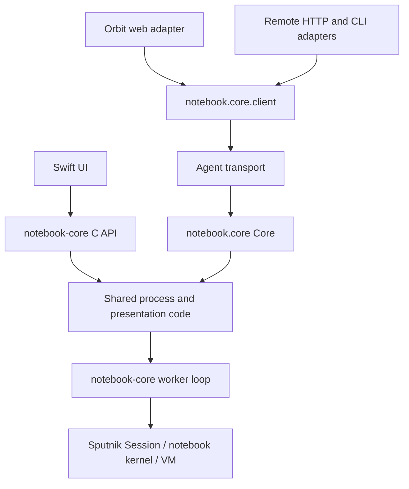

# Shared notebook-core extraction

26 October 2026. Development changes remain uncommitted and unpublished.

The implementation lives in
[`packages/notebook-core`](../../packages/notebook-core/README.md). Native
execution previously under `tools/notebook-macos` and durable execution previously
under `tools/notebook-remote` now belong to one package. Frontends depend on the
package, rather than importing another application's tool directory.

The native archive and Sputnik package are two bindings of the same execution
stack. They are not two implementations of the language evaluator. Core's
persistent coordination is reused directly by the agent; its HTTP/CLI layers
retain protocol and launch compatibility. The C ABI retains its symbols and
ownership rules, so Swift models/views need no execution rewrite.

The package API supports direct calls (`Core.handle`) and private IPC
(`Client.handle`) with the same method/data contract. Core creates storage and
an exclusive owner lease, but no listener or authentication credentials. The
remote adapter creates its token and binds IPC/HTTP. Multi-user ACL belongs to
the Orbit application and must be enforced before these privileged calls.

This extraction preserves document storage, command IDs, revisions, runtime
identity, source installation rules, cancellation, live/terminal binary
presentations and no-replay recovery. The worker IPC version stays 17.

The compiler checkout continues to own its existing low-level notebook graph,
Session, compiler and VM modules, also used by isputnik. This package composes
those sources into one frontend-neutral archive through `mk/notebook-core.mk`.
Moving language/runtime ownership between repositories is not required to
separate notebook execution from its interfaces.

Next integration uses Core's existing document/run/events API through the IPC
client. Browser DTOs, project ACL and Vue components belong to notebook-web.
GUI-only scheduling/draft state remains in Swift until those adapters migrate;
web execution uses the agent's existing durable Services policy.

## Local documents, server accounts and maintenance

Electron/native hosts open local `.sputnikbook` directories through the embedded
document/execution adapter. Local use requires no GitHub login, application User,
server Project row or automatic upload. The document format and execution kernel
remain independent of the web application's account and ACL models.

Server project ownership is enforced by the Orbit adapter around server
ProjectId operations. Importing/publishing a local book to that server is an
explicit operation. A local book with no server account/project mapping is not
an orphan eligible for server cleanup.

Orphan cleanup belongs to a separate future background maintenance process and
is outside the current implementation scope. The extraction retained the existing
optional agent GC task unchanged; its CLI interval defaults to zero. A separate
OS process has not been introduced. Account/session/project operations must not
start cleanup, and this stage does not enable or redesign the existing GC.

During extraction, a remote inputs regression exposed a stale-wakeup race.
Worker Poll previously treated a Session activity hint as pending Watch work.
Hints can outlive an explicit input wave, producing an empty durable Watch run.
The shared Session now exposes a read-only readiness probe against its actual
watch cursor; Poll discards stale scheduling hints only when that probe is idle.
It neither acknowledges events nor executes code. The original remote regression
and new worker/session readiness tests cover this boundary.

## Resource policies

Core owns hierarchical retention/storage/execution policies and disposable sessions.
See [configuration, API and lifetime guarantees](notebook-resource-policies.md).
The default retention is 100 runs per project; a public preview copy has a 60-second
aggregate execution budget and a renewable 15-second lease. The supervisor works
without a gateway or adapter polling loop.
