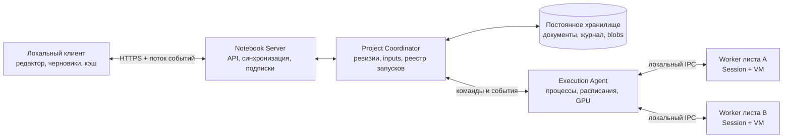

# Удалённое выполнение Sputnik Notebook

Статус: архитектурное предложение, 2026-10-13. Реализация не входит в этот документ.

Первый реализуемый этап описан отдельно: [Remote core P01](notebook-remote-core-p01.md), 2026-10-14. Его ограничения не заменяют целевой контракт ниже.

Цель: пользователь редактирует обычный ноутбук в локальном приложении, а его runtime живёт на сервере, в том числе GPU-сервере. Закрытие приложения и потеря сети не завершают выполнение. После подключения пользователь получает актуальный документ, живые runtime и результаты. Сервер хранит исходники и структуру проекта, необходимые для понимания и управления каждой работающей задачей.

Начальный масштаб: один сервер исполнения, один активный редактор проекта, несколько подключений для просмотра. Границы компонентов позволяют позже добавить несколько серверов; распределённый планировщик и совместное редактирование не нужны для первого варианта.

## 1. Основное решение

Владельцем воркера становится постоянный серверный Execution Agent. Клиент подключается к серверному проекту и подписывается на его события. Соединение клиента — временная подписка; проект, runtime и запуск имеют независимые идентификаторы и жизненные циклы.

Необходимо различать:

1. **Редактируемый документ:** текущие модули, листы, доски, определения inputs и ресурсы, включая синхронизированные черновики.
2. **Снимок выполнения:** неизменяемая версия исходников, окружения, входных значений и ресурсов, выбранная для конкретного запуска.
3. **Живой runtime:** процесс, VM, heap, загруженные модули, GPU-объекты и зарегистрированные задачи.
4. **Историю выполнения:** состояния запусков, результаты, диагностику, логи, артефакты и пользовательские checkpoints.

Синхронизация документа не подменяет исходники внутри выполняющегося вызова. Изменение документа и применение новой версии к runtime — разные операции.

## 2. Существующая база проекта

Архитектура продолжает уже существующее разделение:

- `.sputnikbook` хранит документ, модули и ссылки на зависимости; heap и результаты не являются частью формата документа.
- Каждый лист имеет собственный runtime. Доска описывает интерфейс и связывается с листом; отдельная VM для обычной доски не нужна.
- `NotebookExecution` владеет постоянными процессами листов; `Process` обеспечивает запуск, IPC, Stop, Force Stop и подтверждение завершения процесса.
- Текущий внутренний worker protocol имеет версию 10, generation/request, команды Load/Sync/Source/Run/Apply и переносимые presentation snapshots. По IPC не передаются heap Values.
- В `main.cpp` потеря родительского data channel завершает воркер. В удалённой схеме этим родителем должен быть серверный агент, а не сетевой клиент.
- Worker preview ещё явно ограничивает isolated module Run. Обычные project inputs и атомарный Apply реализованы в [P0](notebook-p0-components.md). Периодическое выполнение планируется локальным Swift Timer. Полная семантика удалённого режима требует закрыть оставшиеся разрывы.

Источники: [worker protocol](../../tools/notebook-worker/protocol.h), [worker lifecycle](../../tools/notebook-worker/main.cpp), [host execution](../../tools/notebook-macos/NotebookExecution.cpp), [periodic scheduling](../../tools/notebook-macos/NotebookModel.swift), [формат проекта](../../../sputnik-lang/docs/engineering/notebook-project-v1.md), [зависимости](../../../sputnik-lang/docs/engineering/notebook-dependencies-v1.md).

## 3. Компоненты и границы отказа

**Клиент** владеет редактором, локальными несинхронизированными правками, выбором вкладки и отображением. Он хранит последнюю общую ревизию, устойчивую очередь изменений и последний принятый номер события. Закрытие окна освобождает подписку, а не процесс на сервере.

**Notebook Server / Project Coordinator** принимает и проверяет изменения документа, публикует ревизии, хранит inputs и реестр исполнения, проверяет права, принимает Run/Apply/Stop. Обработка документа не блокируется длинным вычислением. Эти компоненты могут находиться в одном сервисе.

**Execution Agent** — отдельный постоянный процесс на вычислительном узле. Только он владеет `Process`, локальными IPC-дескрипторами и процессами воркеров. Он постоянно читает worker output, даже когда клиентов нет, ведёт локальный устойчивый журнал команд/событий и управляет расписаниями. Перезапуск API или Project Coordinator не должен уничтожать агент.

**Worker** исполняет пользовательский код на своём serial owner thread. Один постоянный воркер на активный лист; один выполняющийся Run/Apply на runtime. Листы могут работать параллельно в пределах бюджета узла. Самостоятельный Periodic Work может иметь отдельный runtime, как существующий путь с отдельным runtime key. Подзадачи, использующие объекты листа, остаются в его границе отказа.

## 4. Идентичность и модель данных

| Сущность | Назначение |
|---|---|
| ProjectId | Стабильная серверная идентичность проекта, независимо от имени и локального пути |
| ProjectRevision | Неизменяемая версия полного редактируемого документа и ссылок на файлы |
| EnvironmentRevision | Зафиксированный набор сохранённых модулей, зависимостей и профиля исполнения |
| InputRevision | Версия текущих серверных input values и выбранных входных ресурсов |
| RuntimeId + RuntimeEpoch | Логическая сессия исполнения и конкретное воплощение её процесса |
| RunId | Один запрос выполнения с собственным снимком, состоянием и результатами |
| CommandId | Ключ дедупликации сетевого запроса, сохраняемый клиентом до отправки |
| EventSeq | Порядок опубликованных сервером событий внутри проекта |

Run сохраняет владельца, тип действия, лист/ячейку или компонент, ProjectRevision, фактическую EnvironmentRevision, InputRevision, ExecutionSnapshotId и RuntimeId/epoch. Из реестра всегда можно перейти к исходникам, на которых идёт работа, даже если актуальный документ уже другой.

Нативные ID листов, ячеек, досок и компонентов остаются в документе. Они используются вместе с ProjectId; переименование или перемещение не должно переидентифицировать объект. Удалённые ID сохраняются в tombstones и не переиспользуются. Коллизии объектов, созданных в расходящихся офлайн-копиях, становятся явным конфликтом; автоматически перенумеровывать ID и переназначать bindings нельзя. Можно заранее резервировать диапазоны decimal CellId активному редактору.

Remote binding и общая sync baseline хранятся как инертные метаданные клиента/проекта. Копирование каталога не создаёт второго владельца runtime: копия либо явно подключается к тому же ProjectId, либо становится новым проектом с новым ProjectId и ссылкой на происхождение.

## 5. Серверная копия и синхронизация

Сервер хранит полный документ: листы и их порядок, текст и formatting, Watch/Manual, доски и вложенные layouts, inputs, bundled modules, зависимости и необходимые ресурсы. Неизвестные поля формата сохраняются по текущему контракту проекта.

В первой версии передавать полный `project.json` разумнее, чем создавать универсальный язык структурных patches. Изменённые модули и ресурсы передаются отдельными blobs по хешу. Неизменённые blobs повторно не загружаются. Серверный manifest связывает документ с точными версиями файлов.

Публикация ревизии:

1. Клиент загружает отсутствующие blobs; сервер проверяет размер, хеш, формат и разрешённые member paths.
2. Клиент отправляет документ и file manifest с `base_revision`, CommandId и актуальным правом записи.
3. Сервер проверяет baseline, структурную целостность и наличие всех blobs.
4. Одной транзакцией публикуются новая head revision, запись команды и событие изменения. Положительный ответ выдаётся после долговечной фиксации.

Полузагруженный проект не становится доступен для Run. Запись blobs предшествует ссылкам на них; сбой до commit может оставить только неиспользуемые blobs для последующей уборки.

Обновление head использует compare-and-swap по ревизии. Для HTTP подходит strong ETag / If-Match; несовпадение baseline требует сверки версий, а не перезаписи. Такая проверка предназначена для предотвращения lost updates в [RFC 9110, §13.1.1](https://www.rfc-editor.org/rfc/rfc9110.html#section-13.1.1).

При расхождении сравниваются три версии: последняя общая, текущая локальная и текущая серверная. Изменения независимых объектов можно объединить. Одновременные изменения одного source buffer, delete-versus-edit, перестановки и несовместимые board bindings требуют разрешения конфликта. Черновики сохраняются с обеих сторон; выбор по времени изменения файлов не используется.

В первой версии проект имеет одного активного редактора. Право записи имеет срок и монотонный writer epoch: после передачи права другому клиенту старые изменения и новые Run отклоняются. Истечение этого права не останавливает уже принятые вычисления. Stop проверяет отдельное право управления и точный RunId/runtime epoch, поэтому конфликт редактора не лишает пользователя возможности остановить работу.

**Remote Sync, Save и Apply различаются.** Sync может сохранять на сервере восстановимый черновик, но не снимает локальную отметку unsaved. Save фиксирует выбранную область документа по существующей семантике сохранения вкладок; saved baselines нужны отдельно для листов/модулей/структуры. Apply использует сохранённые версии модулей и явно меняет окружение; как и сейчас, он отклоняется при наличии несохранённых module tabs. Синхронизированный несохранённый модуль не начинает исполняться автоматически.

Офлайн клиент сохраняет правки локально и показывает, какая ревизия последней подтверждена сервером. Новый Run требует связи и подтверждения принятия; реконнект сам не отправляет ранее не принятые намерения выполнить код. Неопределённый результат уже отправленной команды сначала разрешается через CommandId. Для Stop без связи допустимо сохранить поручение на доставку, но интерфейс показывает «ожидает отправки», а не серверное stopping.

## 6. Run, Apply и изменения во время выполнения

Перед Run клиент должен дождаться подтверждения всех правок, которые должны войти в запуск. Сервер отклоняет Run с несовпадающей ожидаемой head revision, удалённым target или недоступными ресурсами. Для первого варианта новый Run/Apply в занятом runtime возвращает Busy; очередь повторных кликов не создаётся. Серверная очередь нужна лишь для принятого запуска, ожидающего ресурсов GPU.

Сервер сначала долговечно создаёт Run и закрепляет execution snapshot, затем поручает агенту выполнение. Ответ «принят» означает, что работу можно найти и продолжить наблюдать без клиента; это ещё не подтверждение начала вычисления.

Запуск в существующем runtime использует его реально загруженную EnvironmentRevision. Новая сохранённая версия модуля сама по себе не заменяет загруженный модуль. Первый явный Run нового runtime подготавливает выбранное окружение; Apply явно устанавливает новое. Успешный Apply сохраняет текущую политику fresh world и Watch/Manual, а другие листы получают environment-stale до собственного явного Apply. Ошибка инициализации сохраняет старое окружение в пределах уже существующих гарантий движка.

Run фиксирует входные значения на момент принятия. Изменённые позже inputs применяются к следующей допустимой invocation; уже выполняющийся вызов продолжает видеть свой snapshot. При очереди GPU интерфейс показывает, что запуск ожидает ресурсы с ранее зафиксированными inputs.

Во время Run:

- правки продолжают синхронизироваться в серверный документ;
- исполняемый source/environment bundle остаётся неизменяемым;
- агент не отправляет изменяющий Session Sync/Apply в занятый воркер;
- результат записывается с исходными ревизиями независимо от текущего head;
- изменённая или удалённая ячейка получает старый результат в истории запуска, а не как актуальное значение нового кода;
- переносимый результат можно отображать в текущем документе только при совпадении зависимых source revisions, inputs, environment и runtime epoch. Иначе он явно помечен stale/previous run.

Правка layout доски не требует перезапуска листа. Смена controller/binding меняет отображение по ID; результат не может случайно оказаться у нового объекта на той же позиции. Сами board descriptions не превращаются в исполняемый код.

## 7. Протокол и реконнект

Внешний протокол является версионированным API сервиса. Внутренний бинарный IPC остаётся между агентом и воркером; его request IDs не заменяют глобальные RunId и source revisions.

Через HTTPS идут handshake/capabilities, attach/list projects, получение ревизий, upload/download blobs, Sync/Save, Run/Apply и команды управления. Поток событий может использовать WebSocket. Resume cursor, дедупликация и журнал задаются нашим прикладным протоколом; [RFC 6455](https://www.rfc-editor.org/rfc/rfc6455.html) задаёт сам WebSocket transport.

Для изменяющих операций клиент генерирует и сохраняет CommandId до отправки. Повтор с тем же ID и тем же содержимым возвращает ту же ревизию/RunId; тот же ID с другим содержимым отклоняется. Для авторизованного запроса receipt проверяется до новых baseline/lease preconditions, чтобы потерянный ответ не превращался в ложный конфликт. После сетевого таймаута клиент запрашивает состояние CommandId, а не создаёт новый Run. Дедупликация действует также на границе Coordinator–Agent.

Receipt можно сокращать до компактной записи, но нельзя забыть CommandId и затем принять его повтор как новую работу. При ограниченном retention протокол задаёт срок допустимых повторов; запрос за его пределами отклоняется и требует сверки состояния, а не повторного запуска.

Окно «агент отправил Run, но не успел записать подтверждение» нельзя скрывать обещанием exactly-once выполнения кода. Если после отказа факт старта не установить, запуск получает outcome-unknown/interrupted и автоматически не повторяется: внешние побочные эффекты могли уже произойти.

Реконнект:

1. Аутентифицировать клиента и проверить ProjectId, версии протокола и capabilities.
2. Получить согласованный bootstrap: серверную head, inputs, реестр runtime/run, последние presentation snapshots и EventSeq S.
3. Подписаться на события после S; сервер устраняет зазор между bootstrap и подпиской через журнал.
4. Сверить локальную очередь CommandId, разрешить расхождения документа и получить/продлить право записи.
5. Отправить ещё не принятые правки и продолжить наблюдение существующих RunId.

Attach никогда сам не выполняет ячейки. Если история событий уже сокращена, сервер выдаёт новый bootstrap с новым watermark. Клиент применяет события по порядку, игнорирует дубликаты и повторно сверяется при пропуске. Несовместимый клиент может читать поддерживаемые данные, но не изменять/исполнять документ с неизвестной семантикой.

## 8. Вывод, доски и работа без подписчиков

Агент всегда принимает worker output. Медленный клиент и закрытое окно не создают backpressure на VM через сетевое соединение. При временной недоступности Coordinator агент пишет ограниченный устойчивый spool, который затем передаёт с дедупликацией. Локальный spool содержит достаточно provenance, чтобы остановить и идентифицировать каждую работу без API.

Хранение разделяется по назначению:

| Данные | Политика |
|---|---|
| Команды, начало, переходы состояния, итог, ошибки | Долговечный журнал, не теряются при сокращении telemetry |
| stdout/stderr | Сегменты с квотой, явная отметка truncation при достижении лимита |
| Progress и промежуточные figures | Последний snapshot; updates можно объединять |
| Live charts | Ограниченная история/агрегаты с явно описанными пропусками |
| Финальные figures, изображения, файлы, checkpoints | Blobs/артефакты с хешами и политикой хранения |

Большие бинарные артефакты скачиваются отдельно; события содержат ссылки, размеры и хеши. Клиент публикует только полностью проверенный snapshot. Последние presentation snapshots позволяют восстановить доску без повторного вычисления и без хранения всего live stream.

Текущие input values и image selection живут на сервере и восстанавливаются при attach. Defaults остаются свойством документа. Inputs обновляются с проверкой InputRevision и типа. Для существующих активных Watch consumers агент выполняет обычную инвалидацию и event-driven pump в безопасной точке. Новые/неинициализированные, edited или environment-stale листы не начинают вычисления от Sync, attach или input event.

Периодические компоненты имеют сохранённое серверное состояние start/pause и владельца component ID. Расписание выполняет агент, с одной invocation на компонент и без очереди пропущенных ticks. Внешние Stop/Force Stop доступны независимо от scheduler. Изменение исполняемой конфигурации приостанавливает следующие ticks до явного применения; текущий tick завершает старую версию.

Для remote mode нужны два явно выбранных поведения Periodic Work: continue-on-server и pause-with-client. Первое сохраняет запуск при закрытии окна. Для второго потеря presence приостанавливает будущие ticks; текущий tick по умолчанию завершается. Настройка видимости локальной доски не должна незаметно переопределять серверный режим.

## 9. Владение, удаление и защита от сирот

Обязательный инвариант: у любого процесса, задачи и расписания есть долговечный владелец в реестре и закреплённый снимок исполнения. Отсутствие клиентов не означает отсутствие владельца.

В интерфейсе нужен список **«Удалённые выполнения»** проекта, доступный независимо от текущих вкладок и досок. Для каждого элемента показываются origin, версия исходников, runtime epoch, состояние, потребление ресурсов, Stop и переход к истории. Удаление локальной копии каталога не удаляет серверный проект; его можно обнаружить по списку проектов сервера.

| Изменение | Поведение по умолчанию |
|---|---|
| Разрыв сети / закрытие приложения | Принятые Run продолжаются, серверные расписания соблюдают выбранный режим |
| Правка или переименование source owner | Новая ревизия документа; текущий Run остаётся управляемым на старом snapshot |
| Удаление обычной доски | Лист продолжает существовать; удаляются только принадлежащие доске расписания/самостоятельные runtime |
| Удаление листа либо владельца самостоятельной работы | Запрет новых запусков, отмена queued work, durable Stop текущей работы |
| Удаление ячейки внутри Run All | Run остаётся у листа; результаты удалённой ячейки доступны только в истории |
| Удаление ячейки-владельца отдельного долгого Run | Run переводится в retiring и получает durable Stop |
| Изменение модуля | Сохраняется новая версия; текущий runtime использует старую до явного Apply |
| Удаление серверного проекта | Проект становится deleting; новые работы запрещены, все его runtime останавливаются |

Удаление владельца и intent остановки фиксируются одной транзакцией. Stop доставляется через устойчивую очередь управления; удалённый объект остаётся tombstone, а работа видна как retiring/stopping. Окончательно освобождать owner/snapshot можно только после подтверждённого завершения всех принадлежащих ему работ.

Для сохранения работы после удаления её исходного владельца нужна явная операция переноса владения в самостоятельный job проекта. Она сохраняет имя, снимок и доступные controls. Само удаление не должно неявно создавать вечный background job.

Агент сверяет desired state с фактическими процессами. Неизвестный/лишённый владельца процесс в его управляемом контейнере ресурсов останавливается; утраченный процесс получает interrupted. Проверяется identity процесса вместе с runtime epoch и идентичностью агента/загрузки узла: одного PID недостаточно. Старый Stop или поздний output не могут воздействовать на новый epoch.

Idle TTL можно применять только к runtime без активных Run, descendants и серверных subscriptions/tasks, удерживающих мир. Истечение TTL уничтожает heap, сохраняет документ/историю и явно отражается в UI. Для первой версии TTL выключен по умолчанию либо задаётся видимым профилем сервера. Ограничения времени активного Run и бюджета расписания задаются при запуске; клиентский heartbeat не служит таким ограничением.

## 10. Состояния и гарантии отказоустойчивости

Run проходит queued → preparing → running → draining → terminal. Stop переводит его в stopping; Force Stop — в terminating. Итог различает succeeded, failed, cancelled, force-stopped и interrupted/outcome-unknown. Корневой результат не означает успех всех descendants: сохраняются unobserved task failures и текущая семантика drain.

Runtime отдельно имеет idle/busy/stopping/terminated/interrupted. После завершения Run процесс может оставаться idle с живым heap. Новое воплощение процесса получает новый epoch; глобальный epoch не выводится из process-local счётчика generation, который может начинаться заново после перезапуска агента.

Stop идёт по независимому control path и кооперативно отменяет run scope. Force Stop адресуется точному runtime epoch; завершение подтверждается агентом по факту смерти процесса и tracked descendants. Успешная отправка сигнала не равна завершению. Нативные helper processes включаются в управляемую группу ресурсов; нетрекаемая работа расширений находится вне гарантии. Зависший GPU driver требует отдельной диагностики узла.

| Отказ | Гарантия первой версии |
|---|---|
| Клиент, сеть, streaming subscription | Вычисление и серверная фиксация результатов продолжаются |
| API / Project Coordinator | Агент и heap продолжают жить; результаты временно spool-ятся, состояние сверяется после восстановления |
| Execution Agent | С текущим parent-owned IPC возможна потеря всех принадлежащих ему runtime; записи и snapshots сохраняются, replay запрещён |
| Worker / сервер / питание узла | Живой heap теряется; сохраняются долговечно зафиксированные документы, результаты и checkpoints |
| Заполнено хранилище/исчерпан spool | Новые Run отклоняются; telemetry сокращается по контракту, при невозможности сохранить обязательные данные работа контролируемо останавливается |

Reattach к живому runtime и восстановление вычисления после смерти сервера — разные возможности. Первое обязательно. Второе требует явного пользовательского checkpoint/resume, например сохранения модели, optimizer и позиции данных. Общая сериализация VM heap, файловых дескрипторов и GPU contexts в первую версию не входит.

Развёртывание обновлений агента должно учитывать живые runtime: drain обслуживания или явное прерывание. Автоматический restart процесса сервиса сам по себе не сохраняет heap. Worker protocol может позже получить reconnectable server-owned supervisor, если потребуется переживать и замену агента.

## 11. Окружение GPU-сервера и файлы

Сервер не может исполнять ссылку на каталог ноутбука пользователя. Bundled modules копируются; directory dependencies превращаются в явно выбранные snapshots пакетов с manifest, source hashes и содержимым разрешённых ресурсов. PackageId/хеш связывают локальный путь с серверной копией. Обычный Run использует закреплённый набор; обновление окружения происходит через Apply.

EnvironmentRevision включает версию Sputnik, notebook/runtime ABI, версии пакетов, native artifact hashes, target OS/architecture и профиль GPU/backend. Native библиотека для macOS не является артефактом Linux GPU-сервера: нужен совместимый серверный build. Сервер сообщает capabilities, а клиент проверяет доступность требуемого профиля до принятия запуска.

Исходники и зависимости материализуются агентом в версионированный read-only workspace. Рабочий каталог, datasets, scratch и outputs задаются отдельно. Данные можно загрузить как blobs или привязать к разрешённому server dataset/mount с версией; крупный dataset не требуется синхронизировать при каждой правке ячейки. Mutable external resources явно обозначаются как невоспроизводимые; сохранённые исходники сами по себе не фиксируют состояние внешней системы.

Runtime работает с серверными путями. Динамически вычисляемые абсолютные пути к файлам ноутбука не становятся доступными автоматически. Worker не пишет authoritative project document и module sources; изменения результатов и datasets не трактуются как правки исходников. Download/export в локальный проект — отдельная клиентская операция.

## 12. Хранилище, ресурсы и доступ

Для одного сервера достаточно локальной SQLite metadata database и immutable blobs на локальном диске. Режим WAL с synchronous FULL синхронизирует WAL при commit; WAL требует локального хоста и не подходит для разделяемого network filesystem ([SQLite WAL](https://sqlite.org/wal.html)). Агент имеет собственный устойчивый spool. При переходе к нескольким узлам metadata store и blob storage можно заменить без изменения модели Project/Run.

Перед commit ссылки на новый snapshot сервер синхронизирует файлы и каталоги дерева снизу вверх через `fs.sync(path)`, переименовывает готовое дерево и синхронизирует родительский каталог. Manifest также должен быть долговечным до записи head/receipt/events в SQLite. Ошибка на любом из этих шагов не публикует новую head; повтор CommandId после устранения ошибки может закончить публикацию. Это требует файловой системы и накопителя, выполняющих контракт `fsync`.

Нужно хранить проекты/ревизии, saved baselines, environments, inputs, runtime/run registry, command receipts, control outbox, event checkpoints и artifact references. GC учитывает ссылки из текущего документа, запусков, живых runtime, checkpoints и retention истории. Активный snapshot и используемые им dependencies не удаляются.

GPU scheduling управляет числом активных runtime/запусков и ресурсными профилями. Уже завершённый Run может оставлять GPU memory в живом heap; это учитывается отдельно от состояния Run. Без backend support VRAM budget является admission/monitoring policy, а не обещанием жёсткого ограничения памяти.

Сетевой доступ использует TLS, аутентификацию и project-scoped права view/edit/execute/control/delete. Членство в runtime не определяется знанием RunId. File paths, quotas и capability grants валидируются на сервере. Изоляция процесса обеспечивает границу отказа; для чужого кода и нескольких пользователей дополнительно нужна системная изоляция ресурсов и доступа, включая native FFI. Секреты выдаёт серверный профиль, они не входят в source snapshots.

## 13. Граница изменений существующей системы

Ввести host-neutral NotebookBackend с локальным и удалённым вариантом. UI продолжает работать с редакторскими drafts и переносимыми presentations; backend предоставляет sync, Run/Apply, attach/status, stream и control. Сетевой запрос не должен держать локальный execution busy до окончания многодневного запуска; local editor busy и remote runtime busy разделяются.

Reusable notebook engine, формат `.sputnikbook`, Session и семантика исполнения остаются в `sputnik-lang`. Изолированный worker и server execution/control принадлежат `sputnik-notebook`; GPU package предоставляет совместимые native artifacts и backend hooks. Серверный формат snapshots/журнала не становится VM snapshot в `project.json`.

Потребуется:

- перенести владение Process и snapshot reception из GUI host в Execution Agent;
- отделить редакторский документ от server execution registry;
- связать внешние RunId/revisions с внутренними generation/request;
- загружать окружение из серверных immutable bundles вместо клиентских paths;
- добавить typed input control, idle Watch pump и изолированный module Run;
- перенести серверные периодические расписания из Swift Timer в агент;
- учитывать helpers, quotas, stale output и удаление owner на уровне сервиса.

Пользовательская семантика Save/Apply/Run и Watch/Manual не должна зависеть от выбранного backend. Возможность remote режима объявляется через capabilities; неподдерживаемый путь явно отклоняется до запуска.

## 14. Этапы и критерии приёмки

1. **Серверное владение:** агент управляет существующим single-sheet worker, переживает закрытие клиента, хранит Run и presentation. API можно перезапустить без потери живого runtime.
2. **Версии проекта:** полный document mirror, module/resource blobs, saved/draft baselines, закрепление environment/execution snapshots, CAS sync и конфликт при расхождении.
3. **Reattach и управление:** command receipts, атомарный bootstrap + cursor, список удалённых выполнений, Stop/Force Stop, deletion outbox и reconciliation.
4. **Семантическая полнота:** inputs, boards/live streams, idle Watch, module Run, server Periodic Work и переносимые native dependencies.
5. **Эксплуатация GPU:** resource profiles, helper tracking, storage/telemetry quotas, GC, checkpoint artifacts и node diagnostics.

Удалённый backend можно считать эквивалентным локальному после этапа 4 для объявленного набора capabilities; первые этапы являются ограниченным preview.

Обязательные сценарии проверки архитектурного контракта:

- Запуск обучения, закрытие клиента, продолжение вычисления, реконнект с результатами и тем же живым runtime.
- Потерянный ответ Run и повтор CommandId дают один RunId, а не второе обучение.
- Редактирование исходников во время Run сохраняет новые drafts; старый результат не становится результатом нового кода.
- Офлайн-правки после передачи права записи другому клиенту вызывают сверку/конфликт без потери версий.
- Удаление листа или periodic owner без связи с агентом сохраняет durable Stop; после восстановления работа завершается и не теряется из реестра.
- Удаление обычной доски не убивает её существующий controller sheet; удаления источника binding не переназначают вывод.
- Успешный Apply новой EnvironmentRevision сохраняет текущие правила fresh world и stale остальных листов.
- Большой live stream без клиентов имеет ограниченный объём хранения и не блокирует Stop.
- Перезапуск API сохраняет работу; отказ агента/воркера явно сообщает interrupted без автоматического повторения кода.
- Поздние outputs/Stop старого epoch не влияют на новый runtime; GC не удаляет snapshot активного запуска.

Проверки перечислены как требования к будущей реализации. Код и тесты в рамках этого предложения не добавляются.
