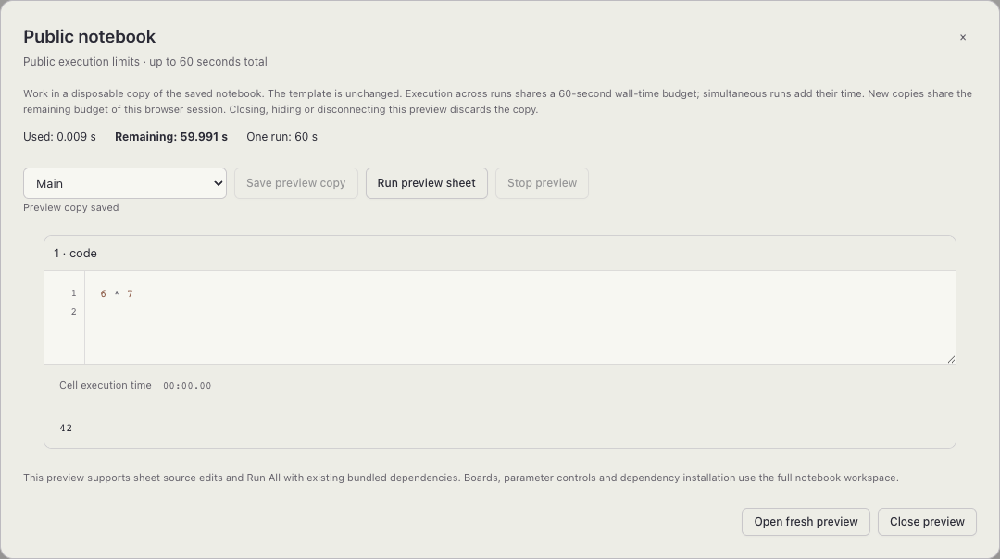
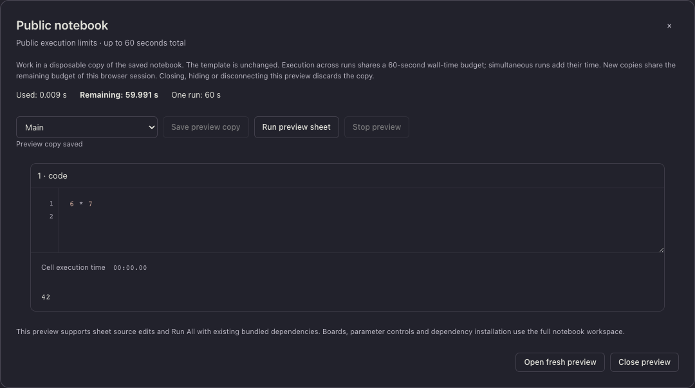
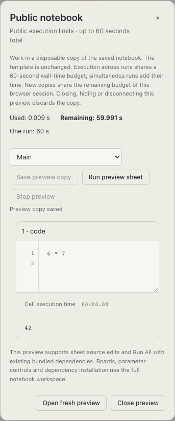
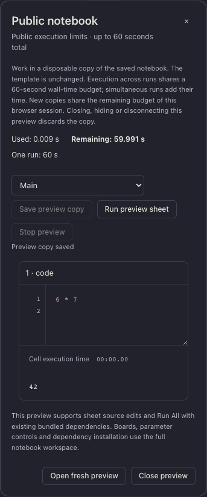

# Notebook web — anonymous public mode

Stage **4i.3**, implemented 1–2 November 2026. Acceptance uses the current workspace
**Sputnik 1.0.0**, SDK HEAD **c17d12b2e25c2dd2cb0b9e41835b0a8e33925573**.
No isolated compiler or SPUTNIK override is used. Existing workspace/SDK changes
are preserved. This is local implementation and acceptance; external deployment
remains **4i.4**.

## Behavior

- The operator opts in with NOTEBOOK_PUBLIC_TEMPLATES / --public-templates.
  Its private allowlist contains at most sixteen id/title/Core source/pinned
  revision entries. Guests see only id/title. Publication stays pinned when the
  source head changes. No Account, Identity, Project or Membership is created
  for a guest. No public path accepts a filesystem path, Core project identity,
  worker grants, billing principal or policy profile.
- The welcome page opens a disposable notebook without login. Opening is inert;
  source/text edits, Save, Run All, Stop/Force Stop and result inspection are
  explicit. Existing Markdown, Sputnik diagnostics and rich outputs are reused.
  Boards, parameter controls and dependency installation use the full workspace.
- Both an encrypted visitor cookie and an opaque copy token are required.
  Cross-visitor access, forged authority, missing CSRF, hostile Origin and private
  APIs remain denied. Public DTOs omit private paths, source identities and
  policy scopes. Dependency installation and inherited worker grants are blocked.
- Core charges **60 seconds of aggregate wall time per visitor across copies**;
  concurrent sheets add their time. Each run is capped at sixty seconds too.
  Book overrides and a replaced public profile cannot raise these ceilings.
  Tighter book/operator ceilings are preserved. New copies and HTTP/Core restarts
  preserve charged visitor time.
- Anonymous storage is capped at **64 MiB per copy/visitor**, with an **8 MiB**
  per-run reservation cap. Core restricts anonymous users atomically without
  replacing stricter operator settings. Lease is at most fifteen seconds and
  lifetime at most fifteen minutes, with temporary persistence enforced.
- Catalog admission serializes one active copy per visitor, sixteen globally,
  ten openings per visitor/hour and 120 globally/hour. An uncertain open keeps
  its reserved Core identity and command receipt. Mutation recovery inspects
  durable receipts; it never automatically repeats code. Opening records older
  than 24 hours are removed once expired on subsequent opens.
- Tokens and uncertain commands stay in memory. Closing, hiding or disconnecting
  the view stops heartbeats and discards the copy. Core independently expires
  copies and stops work. Removing/changing an operator publication revokes access
  to old copies; their short leases still expire independently.

Cookie loss or a different browser represents a new anonymous visitor. This does
not identify a physical person. Global admission, proxy traffic controls and
operator Core/disk ceilings bound the exposed service. Retention of the pinned
source revision is an operator responsibility. See
[operator setup](../../../../apps/notebook-web/deploy/README.md#anonymous-public-notebooks)
and the [implementation plan](../../../engineering/notebook-web-implementation.md).

## Acceptance

The browser scenarios use the actual Core and workers. The anonymous scenarios
do not log in. Private regressions use the existing local GitHub fixture.
The full-duration scenario runs source that sleeps seventy seconds: Core must
publish `force-stopped` after its sixty-second budget, report at least 60000 ms
charged, and leave a fresh copy with zero remaining time and Run disabled.

| Backend | Assets | Result | Log |
| --- | --- | --- | --- |
| VM | Development | 6 passed, 1 intentional skip | [log](browser-vm-development.log) |
| VM | Production | 12 public/resource checks + 10 workspace regressions | [public/resources](browser-vm-production.log), [workspace](browser-vm-workspace.log) |
| Full native | Development | 6 passed, 1 intentional skip | [log](browser-native-development.log) |
| Full native | Production | 29 public/execution/resource/workspace checks | [log](browser-native-production.log) |

Only development skips the full minute; VM and full-native production execute
it. This gives **63 passing browser executions** and **2 intentional skips**.
Desktop/mobile at 1280/375 px and both color schemes were checked for overflow;
the public notebook screenshots were visually inspected.

- [Sputnik adapter integration](public-adapter.log) verifies a pinned revision
  after source-head advancement, inert opens, idempotence, ownership, one/global
  active-copy admission, replaced-profile storage/time/lease restrictions,
  preservation of tighter operator quotas and aggregate parallel-sheet charging.
  Its shell launcher traps exit/signals, waits for its own agent and removes its
  temporary root. New behavior/fixtures are Sputnik; no Python dependency was
  added to build, launch or test tooling.
- [Real backend/main + independent Core probe](production-probe.json) passes six
  groups, including an actual anonymous cookie and positive charged time across
  HTTP/Core restarts. The other groups cover SSR, provenance/CSRF, >1 MiB exact
  upload/download, private assets and signed-account execution/recovery.
  See [result](production-probe.log) and [process log](production-processes.log).
  Its authenticated `run_count` refers to the private project's registry.
- [Process cleanup](process-cleanup.log) / [summary](process-cleanup-summary.json)
  cover VM/development and native/production with SIGTERM and SIGKILL, including
  a real active worker: each test-owned process set reaches zero. A separate
  [final inventory](process-inventory.json) records no remaining notebook test
  processes. Unrelated pre-existing Orbit fixtures and app/plugin processes are
  excluded and untouched.
- [Vue/TypeScript build](frontend-build.log) passes with the existing Vite chunk
  size warning. Native builds have full body coverage and zero VM fallback:
  [Core](core-native-build.log), [main](main-native-build.log),
  [fixture](fixture-native-build.log), [summary](native-summary.json).
  [SDK/checkout identities](identities.json) and [SHA-256 inputs](source-sha256.json)
  identify the exact workspace compiler, locks, relevant sources and binaries.
  [App](package-lock.log) / [Core](core-package-lock.log) locks use Sputnik 1.0.0.

The first native-production pass hit `TCP write: Broken pipe` in the subsequent
private OAuth login after the minute-long public run. The HTTP pool retained an
idle connection longer than the local provider server. The application now gives
each OAuth exchange its own transport/client and closes it after consuming the
bounded response. Authorization codes are never replayed. Acceptance repeats the
full minute followed by private login on VM and native. The original failing run
is retained as [initial native acceptance](browser-native-production-initial.log).
Earlier test authoring also corrected two expectations: malformed dependency
metadata returns 400, and Sputnik string results include their printed quotes.

This probe uses loopback HTTP with the documented original Host and forwarded
HTTPS contract. Live GitHub consent, actual nginx routing/TLS, Linux supervision,
production load/backups and external deployment were not exercised here; they
remain Stage 4i.4. No production service or publication was deployed.

## Screenshots

| Light desktop | Dark desktop |
| --- | --- |
|  |  |

| Light mobile | Dark mobile |
| --- | --- |
|  |  |
